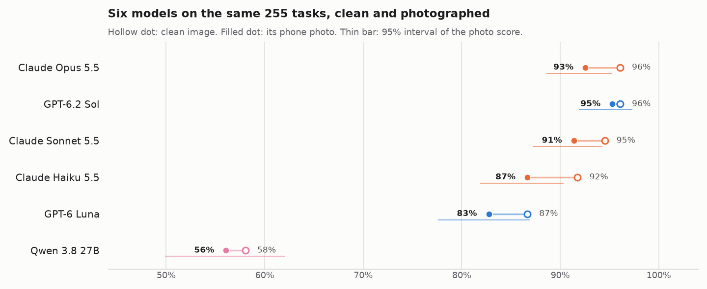

# Visual Task Factory

Visual Task Factory generates questions about images together with their correct answers. Every
image is drawn from data (a chart's values, a needle's reading, a cable layout), and every answer
is calculated from that same data, so no answer depends on a person or a model labelling it. It
covers four kinds of images: business charts, medical and industrial instruments, connection
diagrams and dense scatter plots. Each task goes through checks that don't use any model, and two
difficulty dials make the tasks harder: how much is in the picture, and whether it is re-shot as a
phone photo.

Built by team Plot Twist for Track 2 (Visual Task Factory) of the Innodata AI Hackathon.

**Demo video:** [davisandn.github.io/visual-task-factory](https://davisandn.github.io/visual-task-factory/)
(about four minutes, including a run of the whole pipeline)


## Main findings

Claude Haiku 5.5, Sonnet 5.5 and Opus 5.5 (high effort) answered 990 tasks from the four families,
each one asked on the clean image and on a photographed copy:

| | Haiku 5.5 | Sonnet 5.5 | Opus 5.5 |
|---|---|---|---|
| Clean images, all four families | 92% | 95% | 97% |
| The same tasks, photographed | 84% | 90% | 91% |
| Photographed syringes (127 tasks, all read correctly when clean) | 54% | 84% | 76% |
| Counting about 515 points (11 tasks) | 0% | 27% | 73% |
| Tracing one of 32 identical cables (16 tasks) | 50% | 50% | 75% |

- On clean images of moderate size, all three models get almost everything right, including
  clocks without numerals, dual-scale pressure gauges, 0.5 and 1 mL syringes read to 0.01 mL,
  24-valve networks and 17-gear trains. A new type of image doesn't make a hard test by itself.
- Photos make a clear difference. Re-shot as a phone photo (a slight angle, glare, blur, JPEG
  compression), the same tasks with the same answers drop from 92-97% to 84-91%. Syringes show it
  most clearly because every model reads all of them correctly when clean, and finer scales suffer
  more: Opus gets 61% of the photographed 0.5 and 1 mL syringes right, against 100% of the clean ones.
- Accuracy also falls as more is packed into the picture, and the larger models hold out longer.
  When counting points in a dense plot, Haiku and Sonnet drop below 80% at about 300 points and Opus
  at about 515; at about 800 points Opus gets 13%. When tracing one cable among identical ones,
  Haiku and Sonnet drop below 80% at 24 cables, and Opus at 32.
- The tasks need the image. Asked without it, the models get 0-14% of open-ended questions right
  (none of the counts, 0-3% of instrument readings). Contrast pairs ask the same question about a
  slightly edited image with a different answer, which tells reading apart from guessing.

GPT-6 Luna and GPT-6.2 Sol (OpenAI) and Qwen 3.8 27B (Alibaba's open-weight model, served by
Cerebras) answered a fixed sample of 255 of the 990 tasks (75 per family and 30 for counting), with
the same checks. All six models on those 255 tasks:

| Same 255 tasks | Haiku 5.5 | Sonnet 5.5 | Opus 5.5 | GPT-6 Luna | GPT-6.2 Sol | Qwen 3.8 27B |
|---|---|---|---|---|---|---|
| Clean | 92% | 95% | 96% | 87% | 96% | 58% |
| Photographed | 87% | 91% | 93% | 83% | 95% | 56% |
| Photographed syringes (22 tasks) | 55% | 82% | 77% | 73% | 100% | 0% |
| Counting (30 tasks) | 53% | 67% | 70% | 43% | 70% | 7% |

- GPT-6.2 Sol holds up best on photos. It matches Opus on clean images and is the only model that
  read all 22 photographed syringes correctly. Every other model except Qwen read the 22 clean ones
  correctly.
- Qwen 3.8 27B tends to round to the nearest printed number: it answers 20 psi when the needle is at
  16, and 0.25 mL for 0.21. It reads 2 of the 22 clean syringes correctly. On 87 of its 985 requests
  it used up the 16,000-token budget reasoning and gave no answer, which counts as wrong. No Claude
  or GPT reply hit that limit.



All of these numbers come from the runs committed in [samples/](samples). Each run's `report.html`
has the full breakdown, and the factory can generate new tasks at any difficulty level.

## Judging criteria

Where to find the evidence for each of the five judging criteria:

| Criterion | Evidence |
|---|---|
| Working, repeatable implementation (25%) | One command generates 300 checked tasks in a few seconds ([quick start](#quick-start)), and the [Docker image](#run-it-in-docker) needs nothing else installed. The same seed and config always give the same tasks, pairs and photos: [`tests/test_reproducible.py`](tests/test_reproducible.py) checks this, `vtf rebuild` re-derives any single task, and [CI](.github/workflows/ci.yml) runs the tests, regenerates all five committed samples and compares them, and runs the pipeline inside the Docker image on every push. Every committed task and answer comes from code and a seed; nothing is edited by hand |
| Validity and validation evidence (25%) | Answers are calculated from the scene data and never set by a model ([how answers are computed](#how-answers-are-computed)). Twelve [checks](#validation) that don't use a model: pixel probes that the drawing matches the data, grounding and resolution checks, OCR read-back on clean images and on photos, independent solvers in the tests, contrast pairs, a blind human audit, and mutation tests that break things on purpose to show the checks catch them. The checks caught five real faults during development, listed with their fixes |
| Meaningful variation (20%) | Four families that test different skills: reading charts, reading instrument scales, following connections and counting ([what the factory makes](#what-the-factory-makes)). Each family's difficulty dial changes the image itself (ticks per label, a second scale, Roman or no numerals, 8 to 32 cables, about 30 to 800 points), and photo mode changes how the image is captured while the answer stays the same. Accuracy changes with both, as the [per-level results](#detailed-results) show |
| Originality and engineering judgment (15%) | Photo mode keeps the exact answer by mapping the layout through the camera's perspective, so the legibility checks run again on the photo. Pixel probes check each drawing against its data. Contrast pairs flip the answer with one small edit. Answer balancing, a blind baseline and near-copy removal guard against shortcuts. Answers are typed (numbers with tolerances, names, sets, clock times) and scored by one function shared with the human audit |
| Practical impact and communication (15%) | Each family has a stated cost of error, such as a dose misread by one tick or the wrong cable unplugged. The [results](#main-findings) show the specific conditions where models from three labs start to fail: photographed syringes, dense counts and look-alike cables. A four-minute [demo video](https://davisandn.github.io/visual-task-factory/) walks through the pipeline, and every number comes from the committed runs and their HTML reports |

## What the factory makes

| Family | Images | Questions | Difficulty dial | Why errors matter |
|---|---|---|---|---|
| `charts` | Bar, horizontal, grouped, stacked, line and pie charts | 17 templates: read, compare, rank, count, difference, totals, trends, what-if | Number of categories and series, printed or unprinted values ([hard preset](configs/charts-hard.yaml)) | A wrong figure goes straight into a report or a database |
| `instruments` | Pressure gauges with one or two scales, syringes from 60 mL down to 0.5 mL, analog clocks | Read the needle, the dose or the time; headroom to the red zone, top-up to a prescribed dose, minutes until a given time | 4 levels: ticks per label, a second scale, Roman or no numerals, a second hand | A dose off by one tick; a gauge read on the wrong scale |
| `connections` | Patch panels, cooling-water valve networks, gear trains | Where a cable ends; which tanks the water reaches; which way each gear turns | Cables 8 → 32, networks 4×3 → 8×7, gears 5 → 17 | Unplugging the wrong cable; a tank thought to be isolated that isn't |
| `counting` | Dense scatter plots | How many points are on one side of a line | About 30 → 800 points (6 levels) | Inventory, cell and crowd counts |

Photo mode (`vtf photos`) makes a phone-photo version of every image in a run: the page seen a
few degrees off square on a desk, with uneven lighting, some glare, a little blur, sensor noise and
JPEG compression. A perspective view doesn't change which tick a needle points at or what is
connected to what, so the answer stays the same. The label positions go through the same
perspective, so the legibility checks run again on the photo, and Tesseract reads the labels back
from the photo itself.

## Detailed results


| Family (tasks) | Model | With the image | Photographed | Contrast pairs, both right | Without the image, open-ended | Cost |
|---|---|---|---|---|---|---|
| Charts (300) | Haiku 5.5 | 300 (100%) | 294 (98%) | 270 of 271 | 28 of 266 (11%) | $0.13 |
|  | Sonnet 5.5 | 300 (100%) | 296 (99%) | 270 of 271 | 24 of 266 (9%) | $2.27 |
|  | Opus 5.5 | 300 (100%) | 295 (98%) | 271 of 271 | 22 of 266 (8%) | $4.21 |
| Instruments (300) | Haiku 5.5 | 295 (98%) | 235 (78%) | 293 of 300 | 9 of 300 (3%) | $0.32 |
|  | Sonnet 5.5 | 299 (100%) | 279 (93%) | 298 of 300 | 3 of 300 (1%) | $4.15 |
|  | Opus 5.5 | 300 (100%) | 270 (90%) | 300 of 300 | 3 of 300 (1%) | $7.28 |
| Connections (300) | Haiku 5.5 | 269 (90%) | 266 (89%) | 150 of 193 | 10 of 213 (5%) | $0.53 |
|  | Sonnet 5.5 | 286 (95%) | 276 (92%) | 169 of 193 | 4 of 213 (2%) | $6.06 |
|  | Opus 5.5 | 290 (97%) | 280 (93%) | 178 of 193 | 7 of 213 (3%) | $11.24 |
| Counting (90 of 150) | Haiku 5.5 | 43 (48%) | 40 (44%) | 39 of 90 | 0 of 90 (0%) | $0.25 |
|  | Sonnet 5.5 | 57 (63%) | 42 (47%) | 52 of 90 | 0 of 90 (0%) | $4.29 |
|  | Opus 5.5 | 67 (74%) | 52 (58%) | 60 of 90 | 0 of 90 (0%) | $7.29 |

A model "breaks" at the first difficulty level where its accuracy drops below 80%. Per-level
tables, every reply and the tasks each model got wrong are in each run's `report.html`.

- Instruments: clocks and gauges come through photos fine; syringes don't. Every model reads
  every clean syringe correctly. Photographed, Haiku drops to 43-59% on every syringe of 10 mL or
  less, and Sonnet and Opus to 76% and 61% on the 0.5 and 1 mL ones. Most misses are one tick off,
  in either direction.
- Connections: tracing one cable through many similar crossings gets harder as cables are added.
  At 24 cables Haiku gets 43% and Sonnet 79%, while Opus stays above 80% until 32 cables (75%);
  photographed, Opus drops to 71% at 24. Wrong answers range from the next port to nine ports
  away, as if the model switched cables at a crossing. Valve networks (up to 24 valves) and gear
  trains (up to 17 gears) stay at 89-100% for all three models, clean or photographed.
- Counting: all three models count about 30 points perfectly. Haiku and Sonnet drop below 80% at
  about 300 points (23% and 77%) and Opus at about 515 (73%); at about 800 points Opus gets 13%.
  Photographed, each model breaks one level earlier: Opus goes from 100% to 62% at about 300 points.
  No model gets a count right without the image (0 of 90).
- Charts: all three models answer every clean chart task in both committed chart runs (450
  tasks), and still get 98-99% of them right photographed (Haiku 294, Sonnet 296 and Opus 295 of
  300). Standard charts don't separate these models.

### Six models on the same tasks

GPT-6 Luna, GPT-6.2 Sol and Qwen 3.8 27B answered a fixed sample of each run (`vtf models --sample
75 --seed 0`, and 30 for counting) with all the same checks. The sampler is nested, so their tasks
are a subset of Claude's. Accuracy on the shared tasks, clean → photographed:

| Family (shared tasks) | Haiku 5.5 | Sonnet 5.5 | Opus 5.5 | GPT-6 Luna | GPT-6.2 Sol | Qwen 3.8 27B |
|---|---|---|---|---|---|---|
| Charts (75) | 100 → 100% | 100 → 100% | 100 → 100% | 99 → 96% | 100 → 100% | 97 → 97% |
| Instruments (75) | 97 → 81% | 99 → 95% | 100 → 93% | 92 → 81% | 100 → 100% | 31 → 28% |
| Connections (75) | 93 → 92% | 96 → 92% | 99 → 95% | 87 → 87% | 99 → 99% | 67 → 64% |
| Counting (30) | 53 → 53% | 67 → 60% | 70 → 67% | 43 → 43% | 70 → 63% | 7 → 3% |

On the 11 counting plots with 500 or more points, GPT-6 Luna, GPT-6.2 Sol and Qwen get 0, 2 and 0
right. Cost for the three, including a pilot of 5 tasks per family: GPT-6 Luna $0.32, GPT-6.2 Sol
$3.16, Qwen 3.8 27B $7.21 (November 2026 list prices; Qwen's long reasoning makes it the most
expensive of the three).

## How this meets the brief

| The brief asks for | Here |
|---|---|
| An image family and visual problem with practical impact | Four families: business charts, medical and industrial instruments, connection diagrams, dense plots, each with the cost of an error ([above](#what-the-factory-makes)) |
| An automated pipeline: images, questions, verifiable answers | `vtf generate --family …`: scene data → image and layout record → question → answer computed from the data → checks → package. `vtf pairs` and `vtf photos` add edited and photographed twins |
| Every task requires visual understanding | Answers are balanced so that always guessing the most common one stays near chance; a blind baseline asks each model without the image; contrast pairs flip the answer with a small edit |
| Enough image evidence to answer | A grounding check (everything a question needs is drawn, legible and unobstructed), a resolution check (ticks, gaps and ports far enough apart) and OCR read-back, on the clean image and on its photo |
| A reliable way to check answers | Typed answers (numbers with explicit tolerances, names, sets of names, clock times), scored by the same function in the model evaluation and the human audit |
| Reference answers validated independently of the evaluated model | No model sets an answer. Seed rebuilds, a pixel check that the drawing matches the data, independent solvers in the tests, OCR (Tesseract), a blind human audit |
| Evaluate frontier models: strengths and weaknesses | Six models from three labs: Claude Haiku, Sonnet and Opus 5.5 on all 990 tasks; GPT-6 Luna, GPT-6.2 Sol and Qwen 3.8 27B on a fixed 255-task sample. Each is tested clean and photographed, with and without the image, and compared on the same tasks; accuracy per level shows where each model breaks |

## Quick start

```bash
uv sync
uv run vtf generate --family instruments --n 300 --seed 42   # or charts, connections, counting
uv run vtf pairs out/instruments-seed42                       # contrast twins
uv run vtf photos out/instruments-seed42                      # phone-photo twins
uv run vtf ocr out/instruments-seed42                         # OCR read-back (needs Tesseract)
uv run vtf ocr out/instruments-seed42 --photos                # the same, on the photos
uv run vtf models out/instruments-seed42 -m claude-haiku-5-5 --sample 20   # needs ANTHROPIC_API_KEY
uv run vtf audit out/instruments-seed42 --photos              # blind review page for a person
open out/instruments-seed42/report.html
```

Generating 300 tasks takes a few seconds. Difficulty is set in a config file passed with
`--config`: [`configs/`](configs) lists every setting with its default, and a file only needs the
settings it changes (for example `levels: [0, 0, 0, 1]` for the hardest instruments only).
`vtf models` reads the API keys (`ANTHROPIC_API_KEY`, `OPENAI_API_KEY`, `CEREBRAS_API_KEY`) from the
environment or from a `.env` file, which git ignores. Tesseract: `brew install tesseract` or
`apt install tesseract-ocr`. Tests: `uv run pytest`.

### Run it in Docker

The image contains Python 3.13, Tesseract and the locked dependencies, so nothing else needs to be
installed. CI builds it and runs the pipeline in it on every push.

```bash
docker build -t vtf .
docker run --rm -v "$PWD/out:/app/out" vtf generate --family instruments --n 300 --out out/instruments
docker run --rm -v "$PWD/out:/app/out" vtf pairs out/instruments
docker run --rm -v "$PWD/out:/app/out" vtf photos out/instruments
docker run --rm -v "$PWD/out:/app/out" vtf ocr out/instruments --photos
docker run --rm --env-file .env -v "$PWD/out:/app/out" vtf models out/instruments -m claude-haiku-5-5 --sample 20
docker run --rm --entrypoint pytest vtf -q
```

API keys are not part of the image; `--env-file .env` passes them in at run time. The committed
samples are in the image too, so `vtf compare` and `vtf report` work on them directly.

## How answers are computed

Each task starts from a scene: the values, positions and styling sampled from a seed. Everything
else is derived from the scene.

1. Sample a scene from the seed and the family's config: a chart's data, a needle's value, a
   syringe's dose, a network's pipes and valves, the gears' positions and meshes.
2. Render it with matplotlib. The renderer also writes a layout record: every label and mark it
   drew, with its pixel box and font size, plus probe points whose pixels must be dark or light if
   the drawing matches the scene.
3. Ask a question. A template picks its parameters, and its solver computes the answer from the
   scene with a step-by-step trace. Each question lists the parts of the image it depends on.
4. Validate with the checks below. Rejected candidates are kept in `rejected.jsonl` with the reason.
5. Package the accepted tasks in `tasks.jsonl`, with the images, `summary.json` and `report.html`.

Instrument readings always sit exactly on a tick (a whole minute for clocks) and avoid labelled
ticks, so the ticks have to be counted. The tolerance is just under half a tick, which accepts the
right tick and no other. Chart values use ChartQA's 5% tolerance, but never less than a tenth of a
gridline step.

## Validation

None of these checks uses a model.

| Check | What it rejects or measures |
|---|---|
| Determinism | 10% of images are rebuilt from their seed during generation and must match. CI regenerates all five committed samples, with their pairs and photos, and checks they contain the same tasks |
| Drawing matches the data | Pixel probes: dark where a needle, hand, stopper or closed valve should be, light where an open valve is, solid where two gears mesh, background where two don't |
| Grounding | Anything a question needs that is missing, cut off, under 9 px, or overlapped by other text; label answers (every name, for set answers) that aren't legible in the image |
| Ambiguity and resolution | Chart answers decided by gaps smaller than the printed precision or 5% of the axis; readings whose tolerance is over 20% of the answer; scale ticks, ports, gear gaps or points less than 4 px apart |
| Dedup | Near-copies, by image hash |
| Answer balancing | Skips a valid task when its answer would make up more than 35% of its template (55% for yes/no) |
| Contrast pairs | The same question on a copy with one thing edited so the answer changes (a bar, a needle moved by a tick, a cable re-plugged, a valve flipped, a point moved across the line); both images pass the same checks |
| Photo twins | The same task photographed; the checks run again on the photo, with the layout mapped through the perspective |
| OCR read-back | Tesseract reads back every label each question depends on, from the clean image and from its photo |
| Independent solvers | The tests work out answers a second way: gear directions from which gears the drawing shows touching (not the generator's links), and valve reachability by union-find instead of the family's search |
| Human audit | `vtf audit` builds a review page: a person answers a sample without seeing the reference answers, then marks each reference answer valid, wrong or ambiguous. Tasks a model got wrong are mixed in unmarked |
| Mutation tests | Tests that break things on purpose and check the factory notices: a gear drawn out of mesh or a needle drawn in the wrong place fails the pixel probes; labels removed, overlapped, clipped or hidden behind the legend fail grounding; unreadable values fail the ambiguity check; a contrast edit that doesn't flip the answer is refused; a fixed run must reproduce its recorded tasks exactly (`uv run pytest -k "catches or rejects or flip or reproducib"`) |

| | Charts (300) | Instruments (300) | Connections (300) | Counting (150) |
|---|---|---|---|---|
| Candidates rejected by the checks | 143 (121 too close to call) | 49 (47 near-copies) | 0 | 0 |
| Contrast pairs made | 271 | 300 | 193 (gears have none) | 150 |
| Photo twins that passed the checks | 300 | 300 | 300 | 150 |
| Labels read back by OCR, clean | 1,260 of 1,264 | 1,227 of 1,282 | 2,816 of 2,848 | (no labels asked) |
| Labels read back by OCR, photographed | 1,200 of 1,264 | 1,135 of 1,282 | 2,651 of 2,848 | (no labels asked) |

The checks caught real faults during development. All were fixed before the runs above:

- OCR found value labels in line charts with the line running straight through them. Line
  segments are now part of the layout record, and the grounding check rejects these.
- Opus found a generator bug. In a prototype of the densest gear trains, it answered "None" to
  "which gears turn counterclockwise?" on all five tasks, and it was right: the driving gear had
  been drawn smaller than its recorded size and touched nothing. The pixel probes now check that
  every recorded mesh is drawn touching, and a test moves a gear out of mesh to make sure the check
  fails.
- The pixel probes then flagged six gear trains where the arrow showing gear A's direction
  crossed the gap between two other gears. The arrow is now drawn on gear A itself.
- On photographed 1 mL syringes, OCR could read only 29% of the scale numbers. The numbers are now
  larger and the image narrower, and 76% read back.
- One drawing flaw was spotted by eye: in syringes less than half full, the plunger's thumb press
  was drawn inside the barrel. It now always sits outside the flange; every syringe task was asked
  again, and the photographed syringe scores moved by at most one point.

## Evaluating models

`vtf models` asks each model every sampled task with the image and without it, plus the task's
contrast twin and photo twin. It supports Claude models (`-m claude-opus-5-5`, through the Anthropic
SDK), OpenAI models (`-m gpt-...`) and open-weight models served by Cerebras (`-m cerebras/<model>`,
an OpenAI-compatible API); the last two go through the official openai SDK. Every model gets the
same system prompt and question, with the image first, and Claude and GPT models reason at the
effort set with `--effort`. Replies are scored by the same function as the human audit and cached
in the run folder, so running again costs nothing. The report breaks accuracy down by skill,
template, image type and difficulty level, names the level where each model breaks, compares clean
and photographed accuracy on the same tasks, and lists the tasks each model got wrong.

## Output

Each line of `tasks.jsonl` is one task. An example from `samples/instruments-seed42`, with the
validation details and most of the scene left out (determinism is checked on a 10% sample of
images, so it's `skip` here):

```json
{
  "id": "instruments-000003-syringe_read",
  "image": "images/instruments-000003.png",
  "question": "How much insulin has been drawn into this syringe, in units? Read the scale at the edge of the dark rubber stopper nearest the needle.",
  "answer": {"value": 22.0, "type": "number", "tolerance": 0.45, "unit": "units"},
  "depends_on": ["stopper", "slabel:*", "unit"],
  "trace": ["Stopper edge on the tick 22 units (ticks every 1)"],
  "validation": {"determinism": {"status": "skip"}, "render": {"status": "pass"}, "grounding": {"status": "pass"}, "ambiguity": {"status": "pass"}, "dedup": {"status": "pass"}},
  "scene": {"kind": "syringe", "level": 3, "scale": {"unit": "units", "top": 50.0, "major": 5.0, "minor": 1.0, "decimals": 0}, "value": 22.0, "...": "..."}
}
```

A photo twin (in `photos.jsonl`) is the same task with `"image": "images/…-photo.jpg"`, its own
check results, and `"capture"`: the exact camera settings, so the photo can be rebuilt.

| File | Made by | Contents |
|---|---|---|
| `tasks.jsonl`, `rejected.jsonl`, `images/` | `generate` | Accepted and rejected tasks with every check result |
| `summary.json`, `config.json`, `report.html` | `generate` | Funnel, coverage, shortcut checks and versions; the exact config; the report |
| `pairs.jsonl`, `photos.jsonl` | `pairs`, `photos` | Contrast twins and photo twins |
| `ocr_*`, `photo_ocr_*` | `ocr` | Every label read back, and crops of the misses |
| `model_checks.jsonl`, `model_summary.json`, `model_cache.jsonl` | `models` | Every reply, scored; the breakdowns; the reply cache |
| `audit*.html`, `*audit_summary.json` | `audit` | The review pages and the imported judgments |

## Reproducibility

The same seed and config always give the same tasks, pairs and photos. Only fonts that ship with
matplotlib are used, `uv.lock` pins every dependency and `.python-version` pins Python.
[`tests/test_reproducible.py`](tests/test_reproducible.py) checks a fixed run against recorded
fingerprints, and any task can be rebuilt and compared with its recorded version:

```bash
uv run vtf rebuild instruments-000003-syringe_read --tasks samples/instruments-seed42/tasks.jsonl
```

CI ([.github/workflows/ci.yml](.github/workflows/ci.yml)) regenerates all five committed samples
from their seeds, with their pairs and photos, and checks they contain the same tasks
(`vtf compare`).

## Adding an image family

Implement the `Family` protocol in `src/vtf/core/family.py`: `sample_scene`, `render` (the image and
its layout record), templates with `instantiate` and `solve`, and `facets` for the breakdowns (add a
`difficulty` facet such as `"cables L3"` to get breaking points). `perturb` for contrast pairs and
`check_render` for pixel probes are optional. Register the family in `src/vtf/families/__init__.py`.
[`families/drawing.py`](src/vtf/families/drawing.py) records the layout for any matplotlib drawing.
Checks, photos, OCR, model evaluation, the audit and the report then work without changes.

## Project layout

```
src/vtf/
  cli.py               vtf generate · pairs · photos · ocr · models · audit · report · rebuild · compare
  core/                data models, family contract, config, pipeline, contrast pairs, photo mode
  families/            charts · instruments · connections · counting, and the shared drawing helper
  validators/          grounding, ambiguity and resolution, dedup, answer scoring
  evidence/            model evaluation, OCR read-back, human audit
  clients.py           Anthropic, OpenAI and Cerebras clients, and the reply cache
  report.py            HTML report
configs/               every setting with its default, per family; the hard chart preset
samples/               five committed runs with their pairs, photos, OCR, model results and reports
docs/                  submission texts, deck content, figures, and the demo video with its source
tests/                 pytest suite: families, independent solvers, photos, mutation tests, reproducibility
Dockerfile             the image CI builds and runs the pipeline in
```

## Limitations

- The photos are simulated: a perspective view, lighting, blur, noise and JPEG. Real phone photos
  also have reflections, curved surfaces, focus falloff and motion blur, which would probably make
  them harder for the models.
- There are 7 to 46 tasks per difficulty level, and the counting results cover 90 of the 150
  counting tasks to keep the cost down, so the breaking points are estimates. Each run's report has
  the counts.
- GPT-6 Luna, GPT-6.2 Sol and Qwen 3.8 27B answered 255 of the 990 tasks, which is too few per level
  to place their breaking points, and GPT-6.2 Astra isn't included. Each model ran at one setting:
  Claude and GPT at high effort and Qwen as Cerebras serves it, all with the same prompt and a
  16,000-token budget.
- Gauges are under-represented in the instruments sample (45 of 300 tasks), because different needle
  positions on the same dial look alike to the near-copy check.
- OCR read-back uses a single engine, which misreads Roman numerals and some small blurred digits.
  Its misses are saved with their crops.
