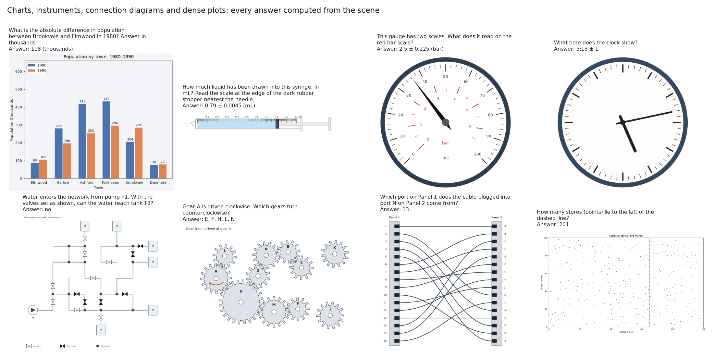
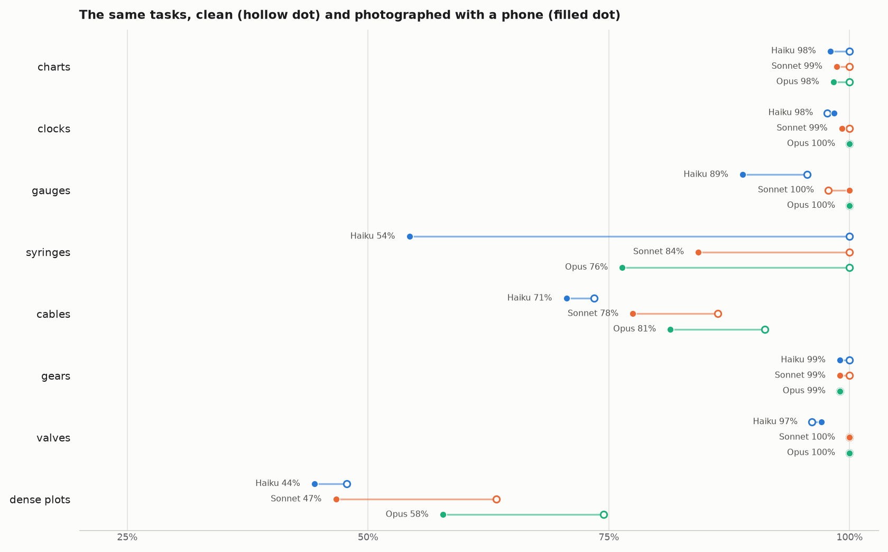
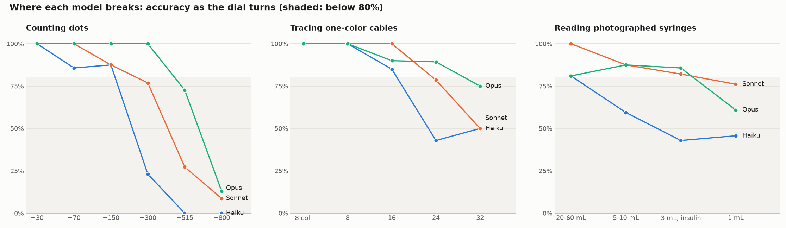

# Visual Task Factory

A factory of image questions whose answers are proven, not labelled, built to find where frontier
vision models break. It draws **charts, medical and industrial instruments, connection diagrams and
dense plots** from data, asks questions about them, works out every answer from that same data, and
checks each task without trusting any model. Then it turns the two dials that real life turns: how
much is in the picture, and whether the picture was taken with a phone.

Built for Track 2 (Visual Task Factory) of the Innodata AI Hackathon by team Plot Twist.



**What it found** with Claude Haiku 5.5, Sonnet 5.5 and Opus 5.5 (high effort) on 990 tasks in four
families, each asked clean and photographed:

| | Haiku 5.5 | Sonnet 5.5 | Opus 5.5 |
|---|---|---|---|
| Clean images, all four families | 92% | 95% | 97% |
| The same tasks, photographed | 84% | 90% | 91% |
| Photographed syringes (each 100% when clean, 127 tasks) | 54% | 84% | 76% |
| Counting about 515 points (11 tasks) | 0% | 27% | 73% |
| Tracing one of 32 identical cables (16 tasks) | 50% | 50% | 75% |

- **Clean images are solved.** Clocks without numerals, dual-scale pressure gauges, 1 mL syringes
  read to 0.01 mL, 24-valve networks and 17-gear trains: all three models answer almost every
  clean task. A new kind of picture does not make a hard test on its own.
- **Photos break them.** Re-shot as a phone photo (a slight angle, glare, blur, JPEG), the same tasks
  with the same answers fall from 92-97% to 84-91%. Syringes show it most clearly, and the finer
  the scale, the worse: Opus reads 61% of photographed 1 mL syringes right, against 100% of the clean ones.
- **Scale breaks them, in order of size.** Counting dense plots breaks Haiku and Sonnet at about 300
  points and Opus at about 515; at about 800, Opus gets 13% right. Tracing one cable among 24
  identical ones breaks Haiku and Sonnet; Opus holds until 32.
- **The tasks need the image.** Without it, the models get 0 to 14% of open-ended questions right
  (none of the counts, 0 to 3% of instrument readings), and contrast pairs (the same question on a
  minimally edited image) separate guessing from reading.

**Across labs.** GPT-6 Luna and GPT-6.2 Sol (OpenAI) and Qwen 3.8 27B (Alibaba's open-weight model,
served by Cerebras) were evaluated on a labelled sample of 255 of the 990 tasks (75 per family, 30
counting), with every check. All six models on those same 255 tasks:

| Same 255 tasks | Haiku 5.5 | Sonnet 5.5 | Opus 5.5 | GPT-6 Luna | GPT-6.2 Sol | Qwen 3.8 27B |
|---|---|---|---|---|---|---|
| Clean | 92% | 95% | 96% | 87% | 96% | 58% |
| Photographed | 87% | 91% | 93% | 83% | 95% | 56% |
| Photographed syringes (22 tasks) | 55% | 82% | 77% | 73% | 100% | 0% |
| Counting (30 tasks) | 53% | 67% | 70% | 43% | 70% | 7% |

- **GPT-6.2 Sol holds up best on photos.** It ties Opus clean and is the only model that read all 22
  photographed syringes right. Every other model except Qwen read all 22 clean.
- **Qwen 3.8 27B reads to the nearest printed number.** It answers 20 psi where the needle sits at 16
  and 0.25 mL for 0.21; it reads 2 of the 22 clean syringes right. On 87 of its 985 requests it spent
  the whole 16,000-token budget reasoning and gave no answer, which counts as wrong (no Claude or GPT
  reply ever hit that budget).


Every number is reproducible from the committed runs in [samples/](samples) (open each
`report.html`), and the factory makes fresh tasks at any level on demand.

## What the factory makes

| Family | Images | Questions | Difficulty dial | Why a misread matters |
|---|---|---|---|---|
| `charts` | Bar, horizontal, grouped, stacked, line and pie charts | 17 templates: read, compare, rank, count, difference, totals, trends, counterfactuals | Categories and series, printed or unprinted values ([hard preset](configs/charts-hard.yaml)) | A wrong figure flows silently into a report or a database |
| `instruments` | Pressure gauges with one or two scales, syringes from 60 mL to 1 mL, analog clocks | Read the needle, the dose, the time; headroom to the red zone, top-up to a prescribed dose, minutes until a time | 4 levels: ticks per label, a second scale, Roman or no numerals, a second hand | A dose misread by one tick; a gauge read on the wrong scale |
| `connections` | Patch panels, cooling-water valve networks, gear trains | Where a cable ends; which tanks water reaches; which gears turn which way | Cables 8 → 32, networks 4×3 → 8×7, gears 5 → 17 | Unplugging the wrong cable; a tank thought isolated that isn't |
| `counting` | Dense scatter plots | How many points lie on one side of a line | ~30 → ~800 points (6 levels) | Inventory, cell and crowd counts |

**Photo mode** (`vtf photos`) re-shoots every image of a run as a phone photo: the page seen a few
degrees off square on a desk, with uneven light, a soft glare, a little blur, sensor noise and JPEG
compression. A perspective view keeps which tick a needle points at and what connects to what, so
the answer can't change. The label positions go through the same perspective, so the legibility
gates run again on the photo itself, and Tesseract reads the labels back from the photo pixels.

## Results





| Family (tasks) | Model | With the image | Photographed | Contrast pairs, both right | Without the image, open-ended | Cost |
|---|---|---|---|---|---|---|
| Charts (300) | Haiku 5.5 | 300 (100%) | 294 (98%) | 270 of 271 | 28 of 266 (11%) | $0.13 |
|  | Sonnet 5.5 | 300 (100%) | 296 (99%) | 270 of 271 | 24 of 266 (9%) | $2.27 |
|  | Opus 5.5 | 300 (100%) | 295 (98%) | 271 of 271 | 22 of 266 (8%) | $4.21 |
| Instruments (300) | Haiku 5.5 | 295 (98%) | 235 (78%) | 293 of 300 | 9 of 300 (3%) | $0.32 |
|  | Sonnet 5.5 | 299 (100%) | 279 (93%) | 298 of 300 | 3 of 300 (1%) | $4.15 |
|  | Opus 5.5 | 300 (100%) | 270 (90%) | 300 of 300 | 3 of 300 (1%) | $7.28 |
| Connections (300) | Haiku 5.5 | 269 (90%) | 266 (89%) | 150 of 193 | 10 of 213 (5%) | $0.53 |
|  | Sonnet 5.5 | 286 (95%) | 276 (92%) | 169 of 193 | 4 of 213 (2%) | $6.06 |
|  | Opus 5.5 | 290 (97%) | 280 (93%) | 178 of 193 | 7 of 213 (3%) | $11.24 |
| Counting (90 of 150) | Haiku 5.5 | 43 (48%) | 40 (44%) | 39 of 90 | 0 of 90 (0%) | $0.25 |
|  | Sonnet 5.5 | 57 (63%) | 42 (47%) | 52 of 90 | 0 of 90 (0%) | $4.29 |
|  | Opus 5.5 | 67 (74%) | 52 (58%) | 60 of 90 | 0 of 90 (0%) | $7.29 |

Per-level tables, every reply and the tasks each model got wrong are in each run's `report.html`.

- **Instruments.** Clocks and gauges survive the camera; syringes don't. Each model reads every
  clean syringe right; photographed, Haiku drops to 43-59% from the 5 and 10 mL syringes down,
  Sonnet to 76% and Opus to 61% on 1 mL syringes. The misses are mostly one tick off, in both
  directions: the precision the clean image allows is lost in the photo.
- **Connections.** Following one cable through many look-alike crossings breaks every model, in
  order of size: Haiku falls to 43% at 24 cables, Sonnet to 79%, and Opus holds until 32 cables
  (75%); photographed, Opus drops to 71% at 24. The misses land anywhere from the next port to
  nine away, as if the model switched cables at a crossing. Valve networks (up to 24 valves) and
  gear trains (up to 17 gears) stay at 89 to 100% for all three, clean or photographed: reasoning
  over a network is solved; following one line among many is not.
- **Counting.** Every model counts about 30 points perfectly. Haiku and Sonnet break at about 300
  points (23% and 77%) and Opus at about 515 (73%); at about 800, Opus gets 13% right. Photographed,
  each breaks a level earlier: Opus falls from 100% to 62% at about 300 points. No model guesses a
  count without the image (0 of 90).
- **Charts.** All three models answer every clean chart task in both committed runs (450 tasks).
  Photographed, they still answer 98 to 99% (Haiku 294, Sonnet 296 and Opus 295 of 300): ordinary
  charts survive the camera. Contrast pairs remain the only thing that separates the models on charts.

### Six models on the same tasks

GPT-6 Luna, GPT-6.2 Sol and Qwen 3.8 27B answered a labelled sample of each run (`vtf models
--sample 75 --seed 0`, and 30 for counting), every check included; the sampler is nested, so their
tasks are a subset of Claude's. Accuracy on those shared tasks, clean → photographed:

| Family (shared tasks) | Haiku 5.5 | Sonnet 5.5 | Opus 5.5 | GPT-6 Luna | GPT-6.2 Sol | Qwen 3.8 27B |
|---|---|---|---|---|---|---|
| Charts (75) | 100 → 100% | 100 → 100% | 100 → 100% | 99 → 96% | 100 → 100% | 97 → 97% |
| Instruments (75) | 97 → 81% | 99 → 95% | 100 → 93% | 92 → 81% | 100 → 100% | 31 → 28% |
| Connections (75) | 93 → 92% | 96 → 92% | 99 → 95% | 87 → 87% | 99 → 99% | 67 → 64% |
| Counting (30) | 53 → 53% | 67 → 60% | 70 → 67% | 43 → 43% | 70 → 63% | 7 → 3% |

On the 11 counting plots with 500 or more points, GPT-6 Luna, GPT-6.2 Sol and Qwen get 0, 2 and 0
right. Spent on the three, including a 5-task-per-family pilot: GPT-6 Luna $0.32, GPT-6.2 Sol $3.16,
Qwen 3.8 27B $7.21 (list prices from November 2026; Qwen's long reasoning makes it the dearest).

## How this meets the brief

| The brief asks for | Here |
|---|---|
| An image family and visual problem with practical impact | Four families: business charts, medical and industrial instruments, connection diagrams, dense plots; each with a stated cost of error ([above](#what-the-factory-makes)) |
| An automated pipeline: images, questions, verifiable answers | `vtf generate --family …`: scene data → image + layout record → question → answer computed from the data → gates → package; `vtf pairs` and `vtf photos` add edited and photographed twins |
| Every task requires visual understanding | Answers balanced so guessing the commonest stays near chance; a blind baseline asks each model without the image; contrast pairs flip the answer with a minimal edit |
| Enough image evidence to answer | Grounding gate (everything a question needs is drawn, legible and unobstructed), a resolution gate (ticks, gaps and ports far enough apart), OCR read-back, on the clean image and on its photo |
| A reliable way to check answers | Typed answers (numbers with explicit tolerances, names, sets of names, clock times) scored by one function shared by the model evaluation and the human audit |
| Reference answers validated independently of the evaluated model | No model sets an answer. Seed rebuilds, a pixel check that the drawing matches the data, independent solvers in the tests, OCR (Tesseract), a blind human audit |
| Evaluate frontier models: strengths and weaknesses | Six models from three labs: Claude Haiku, Sonnet and Opus 5.5 on all 990 tasks; GPT-6 Luna, GPT-6.2 Sol and Qwen 3.8 27B on a labelled 255-task sample; each clean and photographed, with and without the image, compared on the same tasks; accuracy per level shows where each model breaks |

## Quick start

```bash
uv sync
uv run vtf generate --family instruments --n 300 --seed 42   # or charts, connections, counting
uv run vtf pairs out/instruments-seed42                       # contrast twins
uv run vtf photos out/instruments-seed42                      # phone-photo twins
uv run vtf ocr out/instruments-seed42                         # OCR read-back (needs Tesseract)
uv run vtf ocr out/instruments-seed42 --photos                # ... from the photos
uv run vtf models out/instruments-seed42 -m claude-haiku-5-5 -m claude-opus-5-5   # needs ANTHROPIC_API_KEY
uv run vtf audit out/instruments-seed42 --photos              # human audit page for the photos
open out/instruments-seed42/report.html
```

One command makes 300 validated tasks in 5 to 15 seconds. Turn a dial with a config file: every
setting and its default is listed in [`configs/`](configs), and a file only needs the settings it
changes (for example `levels: [0, 0, 0, 1]` for the hardest instruments only). `vtf models` reads
each provider's key (`ANTHROPIC_API_KEY`, `OPENAI_API_KEY`, `CEREBRAS_API_KEY`) from the
environment or a `.env` file (git-ignored). Tesseract: `brew install
tesseract` or `apt install tesseract-ocr`. Tests: `uv run pytest`.

### Run it in Docker

The image holds Python 3.13, Tesseract and the locked dependencies, so nothing else needs
installing; CI builds it and runs the pipeline inside it on every push.

```bash
docker build -t vtf .
docker run --rm -v "$PWD/out:/app/out" vtf generate --family instruments --n 300 --out out/instruments
docker run --rm -v "$PWD/out:/app/out" vtf pairs out/instruments
docker run --rm -v "$PWD/out:/app/out" vtf photos out/instruments
docker run --rm -v "$PWD/out:/app/out" vtf ocr out/instruments --photos
docker run --rm --env-file .env -v "$PWD/out:/app/out" vtf models out/instruments -m claude-haiku-5-5 --sample 20
docker run --rm --entrypoint pytest vtf -q
```

API keys are never part of the image: `--env-file .env` passes them in at run time. The committed
samples are inside the image too, so `vtf compare` and `vtf report` work on them directly.

## How reference answers are established

**Data first, image second.** Every task starts as a *scene*: values, positions and styling sampled
from a seed. Everything else is derived from it.

1. **Sample** a scene from the seed and the family's config: a chart's data, a needle's value, a
   syringe's dose, a network's pipes and valves, the gears' positions and meshes.
2. **Render** it with matplotlib. The renderer also writes a *layout record*: every label and mark it
   drew, with its pixel box and font size, plus *probe points* whose pixels must be dark or light if
   the drawing matches the scene.
3. **Ask.** A template picks its parameters, and its solver computes the answer from the scene, with
   a step-by-step trace. Each question lists the parts of the image it depends on.
4. **Validate** with the gates below. Failures are kept in `rejected.jsonl` with the reason.
5. **Package** accepted tasks in `tasks.jsonl`, with images, `summary.json` and `report.html`.

Readings sit exactly on a tick (a whole minute, for clocks), and avoid labelled ticks so the ticks
must be counted; the tolerance, just under half a tick, accepts the right tick and no other. Chart
values follow ChartQA's 5%, never tighter than a tenth of a gridline step.

## How they are validated, independently of the model under test

| Check | What it rejects or measures |
|---|---|
| **Determinism** | 10% of images are rebuilt from their seed during generation and must match. CI regenerates all four committed samples, with their pairs and photos, and checks they hold the same tasks |
| **Drawing matches the data** | Pixel probes: dark where a needle, hand, stopper or closed valve should be, light where an open valve is, solid where two gears mesh, background where two don't |
| **Grounding** | Anything a question needs that is missing, cut off, under 9 px, or overlapped by other text; label answers (every name, for set answers) not legible in the image |
| **Ambiguity and resolution** | Chart answers decided by gaps under the printed precision or 5% of the axis; readings whose tolerance is over 20% of the answer; scale ticks, ports, gear gaps or points under 4 px apart |
| **Dedup** | Near-copies by image hash |
| **Answer balancing** | Skips a valid task when its answer would make up more than 35% of its template (55% for yes/no) |
| **Contrast pairs** | The same question on a copy with one thing edited so the answer changes (a bar, a needle by a tick, a cable re-plugged, a valve flipped, a point moved across the line); both images pass the same gates |
| **Photo twins** | The same task photographed; the gates run again on the photo with the layout mapped through the perspective |
| **OCR read-back** | Tesseract reads back every label each question depends on, from the clean image and from its photo |
| **Independent solvers** | The tests re-derive answers another way: gear directions from which gears the drawing shows touching (not the generator's links), valve reachability by union-find instead of the family's search |
| **Human audit** | A person answers a sample blind, then judges each reference answer; tasks a model got wrong are mixed in unmarked |
| **Mutation tests** | Tests that break things on purpose and check the factory notices: a gear drawn out of mesh or a needle drawn in the wrong place fails the pixel probes; labels removed, overlapped, clipped or hidden behind the legend fail grounding; unreadable values fail the ambiguity gate; a contrast edit that doesn't flip the answer is refused; a fixed run must reproduce its recorded tasks exactly (`uv run pytest -k "catches or rejects or flip or reproducib"`) |

| | Charts (300) | Instruments (300) | Connections (300) | Counting (150) |
|---|---|---|---|---|
| Candidates rejected by the gates | 143 (121 too close to call) | 49 (47 near-copies) | 0 | 0 |
| Contrast pairs made | 271 | 300 | 193 (gears have none) | 150 |
| Photo twins that passed the gates | 300 | 300 | 300 | 150 |
| Labels read back by OCR, clean | 1,260 of 1,264 | 1,227 of 1,282 | 2,816 of 2,848 | (no labels asked) |
| Labels read back by OCR, photographed | 1,200 of 1,264 | 1,135 of 1,282 | 2,651 of 2,848 | (no labels asked) |

The checks found real faults while this was built, each fixed before the results above:

- **OCR** found value labels that a line in a line chart ran straight through; line segments are now
  part of the layout record, and the grounding gate rejects them.
- **A model caught a generator bug.** In a prototype of the densest gear trains, Opus answered
  "None" to "which gears turn counterclockwise?" on all five tasks, and it was right: the driving
  gear had been drawn smaller than its recorded size, so it touched nothing. The pixel probes now
  check that every recorded mesh is drawn touching, and a test moves a gear out of mesh to confirm
  the check fails.
- **The pixel probes** then flagged six gear trains where the arrow showing gear A's direction
  crossed the gap between two other gears; the arrow now sits on gear A's own face.
- **Photo legibility.** OCR could read only 29% of the scale numbers on photographed 1 mL syringes;
  the numbers are now larger and the image narrower, and 76% read back.
- **A drawing flaw, found by looking.** In syringes under half full, the plunger's thumb press was
  drawn inside the barrel. It now always sits outside the flange; every syringe was re-asked, and
  the photographed syringe scores moved by at most one point.

## Evaluating models

`vtf models` asks each model every sampled task with its image and without it, plus the contrast
twin and the photo twin of each task. It takes Claude models (`-m claude-opus-5-5`, through the
Anthropic SDK), GPT models (`-m gpt-...`, OpenAI's API) and open-weight models served by Cerebras
(`-m cerebras/<model>`, OpenAI-compatible); the last two go through the official openai SDK. Every
model gets the same system prompt and question, with the image first; Claude and GPT models think
at the effort given with `--effort`. Replies are scored with the same rules as the human audit and
cached in the run folder, so re-running costs nothing. The report breaks accuracy down by skill,
template, kind of image and difficulty level, names the level where each model breaks (the first
under 80%), compares clean and photographed accuracy on the same tasks, and shows the tasks each
model got wrong.

## Human audit

```bash
uv run vtf audit samples/instruments-seed42 --photos --n 20 --targeted 20   # writes audit-photos.html
uv run vtf audit samples/instruments-seed42 --import <downloaded results file>
```

The page is self-contained. For each task the reviewer types an answer from the image alone, then
sees the reference answer and its derivation and judges it valid, wrong or ambiguous. Tasks a model
got wrong are mixed in unmarked and reported separately, so the random sample's error rate stays
unbiased; for photos, they show whether a person can read what the models couldn't.
The photo audit of the instruments sample (`audit-photos.html`, 40 tasks) is ready for a reviewer;
its result will be added here.

## Output

Each line of `tasks.jsonl` is one task (scene trimmed):

```json
{
  "id": "instruments-000003-syringe_read",
  "image": "images/instruments-000003.png",
  "question": "How much liquid has been drawn into this syringe, in mL? Read the scale at the edge of the dark rubber stopper nearest the needle.",
  "answer": {"value": 0.79, "type": "number", "tolerance": 0.0045, "unit": "mL"},
  "depends_on": ["stopper", "slabel:*", "unit"],
  "trace": ["Stopper edge on the tick 0.79 mL (ticks every 0.01)"],
  "validation": {"determinism": {"status": "pass"}, "render": {"status": "pass"}, "grounding": {"status": "pass"}, "ambiguity": {"status": "pass"}, "dedup": {"status": "pass"}},
  "scene": {"kind": "syringe", "level": 4, "scale": {"unit": "mL", "top": 1.0, "major": 0.1, "minor": 0.01}, "value": 0.79, "...": "..."}
}
```

A photo twin (`photos.jsonl`) is the same task with `"image": "images/…-photo.jpg"`, its own gate
results, and `"capture"`: the exact camera settings, so the photo can be rebuilt.

| File | Made by | Contents |
|---|---|---|
| `tasks.jsonl`, `rejected.jsonl`, `images/` | `generate` | Accepted and rejected tasks with every gate result |
| `summary.json`, `config.json`, `report.html` | `generate` | Funnel, coverage, shortcut checks, versions; the exact config; the report |
| `pairs.jsonl`, `photos.jsonl` | `pairs`, `photos` | Contrast twins and photo twins |
| `ocr_*`, `photo_ocr_*` | `ocr` | Every label read back, and crops of the misses |
| `model_checks.jsonl`, `model_summary.json`, `model_cache.jsonl` | `models` | Every reply, scored; the breakdowns; the reply cache |
| `audit*.html`, `*audit_summary.json` | `audit` | The review pages; imported judgments |

## Reproducibility

The same seed and config give the same tasks, pairs and photos. Only fonts that ship with matplotlib
are used, `uv.lock` pins every dependency and `.python-version` pins Python.
[`tests/test_reproducible.py`](tests/test_reproducible.py) checks a fixed run against recorded
fingerprints, and any task can be re-derived:

```bash
uv run vtf rebuild instruments-000003-syringe_read --tasks samples/instruments-seed42/tasks.jsonl
```

CI ([.github/workflows/ci.yml](.github/workflows/ci.yml)) regenerates every committed sample from its
seed, with its pairs and photos, and checks it holds the same tasks (`vtf compare`).

## Adding an image family

Implement the `Family` protocol in `src/vtf/core/family.py`: `sample_scene`, `render` (the image and
its layout record), templates with `instantiate` and `solve`, and `facets` for the breakdowns
(include a `difficulty` facet such as `"cables L3"` to get breaking points); optionally `perturb` for
contrast pairs and `check_render` for pixel probes. Register it in `src/vtf/families/__init__.py`.
[`families/drawing.py`](src/vtf/families/drawing.py) records the layout for any matplotlib drawing.
Gates, photos, OCR, model evaluation, audit and report then work unchanged.

## Project layout

```
src/vtf/
  cli.py               vtf generate · pairs · photos · ocr · models · audit · report · rebuild · compare
  core/                data models, family contract, config, pipeline, contrast pairs, photo mode
  families/            charts · instruments · connections · counting, and the shared drawing helper
  validators/          grounding, ambiguity and resolution, dedup, answer scoring
  evidence/            model evaluation, OCR read-back, human audit
  clients.py           Claude client and reply cache
  report.py            HTML report
configs/               every setting with its default, per family; the hard chart preset
samples/               five committed runs with their pairs, photos, OCR, model results and reports
docs/                  submission texts, deck content, figures and the demo video script
tests/                 pytest suite: families, independent solvers, photos, reproducibility
```

## Limitations

- Photos are simulated: a perspective view, light, blur, noise and JPEG. Real phone photos add
  reflections, curved surfaces, focus falloff and motion blur, which would likely cost the models more.
- Eight to forty-six tasks per difficulty level, and counting was evaluated on 90 of its 150 tasks
  to save cost; the breaking points are estimates (each run's report has the counts), and the
  factory can make more tasks at any level.
- GPT-6 Luna, GPT-6.2 Sol and Qwen 3.8 27B were evaluated on a quarter of the tasks (255 of 990) to
  save cost, so their per-level counts are too small to place their breaking points; OpenAI's
  flagship GPT-6.2 Astra was not evaluated. Each model ran at one setting: Claude and GPT at high
  effort, Qwen as Cerebras serves it, all with the same prompt and a 16,000-token budget.
- Gauges are under-represented in the instruments sample (45 of 300 tasks): different needle
  positions on the same dial look alike to the near-copy check.
- OCR read-back uses one engine, which misreads Roman numerals and some small blurred digits; its
  misses are kept with their crops.
