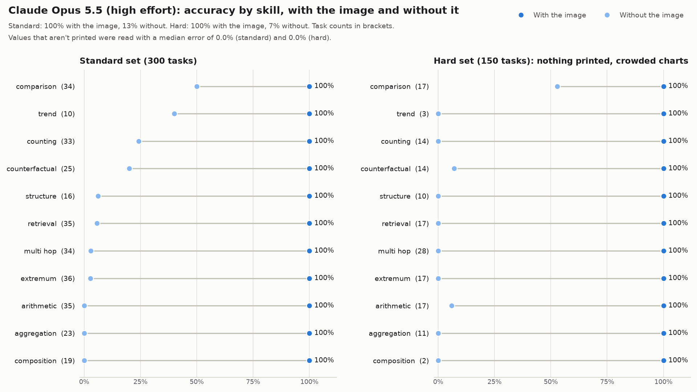
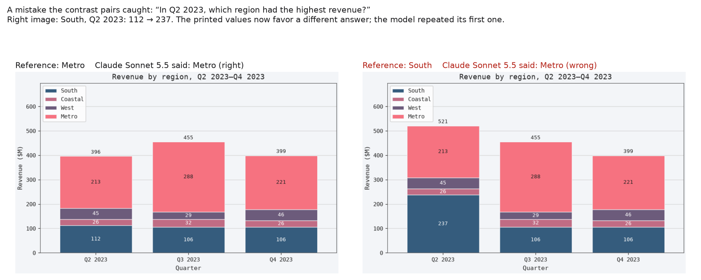

# Visual Task Factory: chart understanding

A pipeline that generates chart images, questions about them, and reference answers that are
**computed from data and checked independently of any model being tested**. It then uses the
tasks to evaluate frontier multimodal models and map where they fail. Built for Track 2 (Visual
Task Factory) of the Innodata AI Hackathon.

One command makes 300 validated tasks in about 6 seconds, and any task can be rebuilt from its
seed. Two evaluated runs are committed:
[samples/charts-seed42](samples/charts-seed42) (300 tasks) and
[samples/charts-hard-seed7](samples/charts-hard-seed7) (150 harder tasks); open their `report.html`.

**Headline result:** Claude Opus 5.5, Sonnet 5.5 and Haiku 5.5 each answered all 450 tasks
correctly and read unprinted values with a median error of 0.2% or less; without the image they
got 2 to 11% of open-ended questions right. Only the contrast pairs separated them: Opus answered
both images right in all 400 pairs, Sonnet in 399, Haiku in 398. The tasks require the image, and
chart reading of this kind is saturated for current models
([details](#results-three-claude-models)).

## How this meets the brief

| The brief asks for | Here |
|---|---|
| An image family and visual problem with practical impact | Business and scientific charts: 6 chart types, 5 topics, 17 question templates across 11 skills ([why charts](#the-application-reading-charts-in-documents)) |
| An automated pipeline: images, questions, verifiable answers | `vtf generate`: scene data → image + layout record → question → answer computed from the data → gates → package |
| Every task requires visual understanding | Answers are balanced so guessing the commonest one stays near chance; contrast pairs flip the answer with a minimal data edit; a blind baseline asks the model without the image |
| Enough image evidence to answer | Grounding gate (everything the question needs is drawn, legible, unobstructed) and OCR read-back of every label a question depends on |
| A reliable way to check answers | Typed answers with explicit tolerances (exact when values are printed, ChartQA's 5% otherwise) and one scoring function shared by the model evaluation and the human audit |
| Reference answers validated independently of the evaluated model | No model ever sets an answer. Checks: seed rebuilds, grounding, ambiguity margins, OCR (Tesseract), blind human audit with a confidence interval |
| Evaluate frontier models and investigate strengths and weaknesses | `vtf models`: accuracy with and without the image, by skill, template, chart type, printed vs unprinted values, label angle and category count; contrast-pair consistency; reading precision. Claude Opus 5.5, Sonnet 5.5 and Haiku 5.5 are evaluated on a standard and a hard preset ([results](#results-three-claude-models)) |

## The application: reading charts in documents

Charts carry the numbers in annual reports, earnings decks, research papers and public
dashboards. Document-AI pipelines increasingly hand them to multimodal models to extract figures
or summarize trends. A misread chart is a quiet error: the model returns a plausible number or
name, nothing flags it, and it flows into a summary, a database or a decision. Knowing exactly
which chart-reading skills a model has, and which it fakes, decides whether its output can be
trusted without a person checking every figure.

The generated tasks reproduce the difficulties real charts pose:

- **Values that aren't printed** and must be read against the axis (half the tasks).
- **Stacked bars**, whose segments don't share a baseline, and **pies**, read by angle.
- **Legends** that map colors to series, **rotated and crowded labels**, up to 9 categories.
- **Reasoning on top of reading**: ranking then reading, differences, totals, counting above a
  threshold, counterfactuals ("if X were doubled, who would lead?"), trends across periods.

## Quick start

```bash
uv sync
uv run vtf generate --n 300 --seed 42          # tasks, images, report.html
uv run vtf pairs out/charts-seed42             # contrast pairs
uv run vtf ocr out/charts-seed42               # OCR read-back (needs Tesseract)
uv run vtf models out/charts-seed42 --sample 100   # evaluate Claude (needs ANTHROPIC_API_KEY)
uv run vtf audit out/charts-seed42             # human audit page
open out/charts-seed42/report.html

# The hard preset: nothing printed, more categories and series, fewer gridlines
uv run vtf generate --config configs/charts-hard.yaml --n 150 --seed 7 --out out/charts-hard-seed7
```

`vtf models` reads the API key from the environment or from a `.env` file (see `.env.example`;
`.env` is git-ignored). Tesseract: `brew install tesseract` or `apt install tesseract-ocr`.
Run the tests with `uv run pytest`.

## How reference answers are established

**Data first, image second.** Each task starts as a *scene*: values, labels and styling sampled
from a seed. Everything else is derived from it.

1. **Sample** a scene from the seed and `configs/charts.yaml`.
2. **Render** it with matplotlib. The renderer also writes a *layout record*: every label, bar,
   point, line segment and pie slice it drew, with its pixel box, font size and, for rotated
   text, its exact corners.
3. **Ask.** A template picks its parameters, and its solver computes the answer from the scene
   data, with a step-by-step trace. Each question lists `depends_on`: the parts of the image the
   question and its answer rely on.
4. **Validate** with the gates below. Failures are kept in `rejected.jsonl` with the reason.
5. **Package** accepted tasks in `tasks.jsonl`, with images, `summary.json` and `report.html`.

Numeric answers carry a tolerance: exact when the values are printed; otherwise 5% (as in
ChartQA) but never tighter than a tenth of a gridline step, doubled for stacked segments read at
both ends, and 3 percentage points per slice for unlabeled pies.

## How they are validated, independently of the model under test

| Check | What it rejects or measures | Result on the standard sample |
|---|---|---|
| **Determinism** | 10% of images are rebuilt from their seed during generation; scene and pixel hashes must match. CI regenerates the committed samples and checks they hold the same tasks | 16 of 16 rebuilds identical |
| **Grounding** | Anything the question needs that is missing, cut off, under 9 px, overlapped by other text or the legend, or crossed by a line; label answers not legible in the image; any colliding text at all | 22 rejected |
| **Ambiguity** | Answers decided by gaps smaller than the printed precision, or than 5% of the axis when values aren't printed; numbers that can't be read to within 20% | 121 rejected |
| **Dedup** | Near-copies (256-bit image hash, Hamming distance ≤ 8) | 0 |
| **Answer balancing** | Skips a valid task when its answer would make up more than 35% of its template (55% for yes/no), so guessing the commonest answer stays near chance | 6 skipped |
| **Contrast pairs** | The same question about a copy of the image with a minimal data edit (one value, or a share moved between two pie slices) so the answer changes; the axis is pinned so nothing else moves. Both images pass the same gates | 271 of 300 tasks paired, median edit 8% of the axis |
| **OCR read-back** | Tesseract, unrelated to any evaluated model, reads every label each question depends on out of the final PNG; rotated labels are straightened first | 1,260 of 1,264 labels (99.7%); the 4 misses are Tesseract reading 5 as 3 |
| **Human audit** | A person answers a random sample blind, then judges each reference answer valid, wrong or ambiguous; the valid rate gets a 95% Wilson interval | `vtf audit` (see below) |

The OCR check earned its place: on its first run it found value labels that a line in a line
chart ran straight through. The layout record didn't include line segments, so the grounding gate
couldn't see it. Segments are now recorded, and the gate rejects those tasks.

The report also lists, per template, the score from always giving the most common answer and how
often a label answer is named in the question, the two shortcuts a model could use without
looking.

## Evaluating frontier models

`vtf models` asks a model every sampled task twice, with the image and without it, and the edited
twin of each paired task. It uses Claude Opus 5.5 by default (`--model` takes any Claude model id
and can be repeated to compare models; `--effort` sets how hard the model thinks). Replies are
scored with the same rules as the human audit and cached in the run folder, so re-running costs
nothing. The report breaks accuracy down by skill, template, chart type, printed vs unprinted
values, label angle and category count, and shows the tasks each model got wrong.

What the measurements separate:

- **With the image vs without it.** Accuracy without the image shows how much a task can be
  guessed; open-ended tasks a model answers blind are listed as guessable.
- **Contrast pairs.** A model that reads the image gets both twins right; one that answers from
  priors can't.
- **Wrong answers go to the human audit first**, because a task the model fails is either hard or
  wrong, and only a person can tell which.
- **Reading precision.** For values that must be read rather than copied, how far the model's
  number is from the truth, whether or not it falls within the tolerance.

### Results: three Claude models

Claude Opus 5.5, Sonnet 5.5 and Haiku 5.5, all at high effort, on every task in both committed
runs, with and without the image, plus every contrast twin (3,900 requests, $6.56 for the results
below).

| Model | Set | With the image | Without it, open-ended | Contrast pairs, both right | Median error reading unprinted values | Cost |
|---|---|---|---|---|---|---|
| Opus 5.5 | Standard, 300 tasks | 300 (100%) | 22 of 266 (8%) | 271 of 271 | 0.0% (90% within 0.5%) | $2.66 |
| Sonnet 5.5 | Standard | 300 (100%) | 24 of 266 (9%) | 270 of 271 | 0.1% (90% within 0.8%) | $1.45 |
| Haiku 5.5 | Standard | 300 (100%) | 28 of 266 (11%) | 270 of 271 | 0.2% (90% within 0.8%) | $0.09 |
| Opus 5.5 | Hard, 150 tasks | 150 (100%) | 2 of 133 (2%) | 129 of 129 | 0.0% (90% within 0.5%) | $1.49 |
| Sonnet 5.5 | Hard | 150 (100%) | 7 of 133 (5%) | 129 of 129 | 0.0% (90% within 0.4%) | $0.82 |
| Haiku 5.5 | Hard | 150 (100%) | 10 of 133 (8%) | 128 of 129 | 0.1% (90% within 0.5%) | $0.05 |

The standard set is [samples/charts-seed42](samples/charts-seed42); the hard set is
[samples/charts-hard-seed7](samples/charts-hard-seed7), made with the
[hard preset](configs/charts-hard.yaml): nothing printed, up to 12 categories and 5 series, fewer
gridlines.



- **All three models answer every original task correctly**, on both sets, at every skill and
  chart type.
- **They read values to the pixel.** On these charts one unit is about one pixel. Opus's median
  error on unprinted values is 0.0%, Sonnet's 0.0 to 0.1%, Haiku's 0.1 to 0.2%, all far inside
  ChartQA's 5% tolerance. The precision follows model size.
- **The tasks need the image.** Without it, the models get 2 to 11% of open-ended questions
  right; the hits are mostly small counts (1 to 4) or a name picked from a handful of candidates.
  Yes/no questions sit at chance. The smaller the model, the more its blind guesses land.
- **Contrast pairs are the only measure that separates them.** Opus got both images right in all
  400 pairs, Sonnet in 399, Haiku in 398. Two of the three misses are the failure pairs exist to
  catch: the model gave its first answer again after the deciding value changed. Sonnet still
  said "Metro" after South's printed value rose from 112 to 237 against Metro's 213; Haiku said
  "Glenrock" with printed values of 116 against Ashford's 123. Haiku's third miss named a bar
  that wasn't in the top two on a crowded 8-bar chart.



**Weaknesses, in short:** single-chart reading at these settings is saturated for current Claude
models. What separates them is consistency, not accuracy: occasionally re-using an answer after
the deciding value has changed, in stacked bars with printed values. Finding where they fail
needs harder task families (more categories than a palette can color, log scales, questions
across several charts) rather than harder settings.

**The evaluation also found defects in the factory, all fixed before the results above:**

- *Scoring.* Opus's first run scored 296 of 300, and all four misses were ours. Twice the scorer
  took the first number from a reply that showed its working ("335 - 238 = 97") instead of the
  final answer. Twice Opus answered "the difference between 2019 and 2016" with a negative
  number, which that wording allowed. Scoring now reads the final answer, and the question asks
  for the absolute difference.
- *An ambiguous question.* Sonnet and Haiku both answered "Spain" to "If Portugal's visitor count
  in 2018 were doubled, which country would have the highest visitor count?" On a chart of four
  years, "highest" didn't say which year; the question now ends "in 2018?".
- *Margins too thin for two kinds of judgment.* Doubling a bar doubles its reading error, so a
  doubled bar's lead now counts half against the ambiguity gate. Unprinted stacked segments above
  the bottom one don't share a baseline and are judged by length, which people do about half as
  precisely, so their gaps count half too. That stricter rule leaves only 2 composition questions
  in the hard set, where nothing is printed.

## Human audit

```bash
uv run vtf audit out/charts-seed42 --n 100                         # writes audit.html
uv run vtf audit out/charts-seed42 --import audit-results-charts-seed42.json
```

`audit.html` is a self-contained page. For each task the reviewer types an answer from the image
alone, then sees the reference answer and its derivation and judges it. Keyboard driven
(`Enter`, `1` `2` `3`, arrow keys), progress saved in the browser, results downloaded as JSON.
Tasks a model got wrong are mixed in unmarked and reported separately, so the random sample's
error rate stays unbiased.

## Question templates

| Template | Skill | Chart types | Example from the sample run | Answer |
|---|---|---|---|---|
| `count_categories` | structure | bar, hbar, grouped, stacked | How many towns does the chart show? | 4 |
| `read_value` | retrieval | all with an axis | What was the output for Wind in 2015? | 434 ± 50 |
| `extremum` | extremum | all with an axis | Which app had the highest user count in June? | Notes |
| `compare_pair` | comparison | all with an axis | Did Photos have a higher user count than Maps in July? | yes |
| `count_above` | counting | all with an axis | How many towns had a population above 150 thousand in 2000? | 3 |
| `difference` | arithmetic | all with an axis | What is the absolute difference in output between Wind and Gas in 2023? | 213 ± 17.5 |
| `rank_then_read` | multi-hop | bar, hbar, grouped | What was the population of the town with the third-highest population in 1990? | 253 |
| `what_if` | counterfactual | bar, hbar, grouped | If Harlow's population in 1990 were doubled, which town would have the highest population in 1990? | Harlow |
| `trend_decreases` | trend | line | How many times did Valley's revenue decrease from one quarter to the next? | 4 |
| `largest_increase` | multi-hop | grouped | Which country had the largest increase in visitor count from 2021 to 2022? | Greece |
| `stack_total` | aggregation | stacked | What was the total visitor count of all countries combined in 2019? | 112.5 ± 5.6 |
| `largest_segment` | composition | stacked | In 2017, which country had the highest visitor count? | Mexico |
| `pie_share` | retrieval | pie | What percentage of the total does Ashford account for? | 28 ± 3 |
| `pie_extremum` | extremum | pie | Which app has the smallest share? | Notes |
| `pie_compare` | comparison | pie | Is Dunmore's share larger than Brookvale's? | yes |
| `pie_combined` | arithmetic | pie | What is the combined share of Maps and Notes? | 49.6 ± 6 |
| `pie_count_above` | counting | pie | How many apps have a share above 15%? | 4 |

Templates are picked per image so accepted tasks stay close to the target shares in the config.
Yes/no answers are balanced at creation; counting questions pick their threshold so the count
itself is spread out; `what_if` names the eventual winner only about 1 time in n.

**Visual variation:** bar, horizontal bar, grouped bar, stacked bar, line and pie charts; five
topics (tourism, sales, energy, apps, population); three fonts; four palettes; three backgrounds;
label rotation; gridlines; legend placement; printed or unprinted values; 3 to 9 categories.

## Output

Each line of `tasks.jsonl` is one task (scene data trimmed here):

```json
{
  "id": "charts-000000-compare_pair",
  "seed": 71586830263575,
  "image": "images/charts-000000.png",
  "question": "Did Photos have a higher user count than Maps in July?",
  "answer": {"value": "yes", "type": "yes_no", "tolerance": 0.0, "unit": null},
  "depends_on": ["cat:4", "cat:3", "bar:0:4", "bar:0:3", "title"],
  "trace": ["Photos = 369, Maps = 258", "higher? → yes"],
  "validation": {"determinism": {"status": "pass"}, "grounding": {"status": "pass"}, "ambiguity": {"status": "pass"}, "dedup": {"status": "pass"}},
  "scene": {"chart_type": "bar", "categories": ["Mail", "Fitness", "Music", "Maps", "Photos"], "...": "..."}
}
```

A run folder holds:

| File | Made by | Contents |
|---|---|---|
| `tasks.jsonl`, `rejected.jsonl`, `images/` | `generate` | Accepted and rejected tasks with every gate result |
| `summary.json`, `config.json`, `report.html` | `generate` | Funnel, coverage, shortcut checks, versions; the exact config; the report |
| `pairs.jsonl`, `pairs_summary.json` | `pairs` | Contrast twins and what was edited |
| `ocr_checks.jsonl`, `ocr_summary.json`, `ocr/` | `ocr` | Every label read back, and crops of the misses |
| `model_checks.jsonl`, `model_summary.json`, `model_cache.jsonl` | `models` | Every reply, scored; the breakdowns; the reply cache |
| `audit.html`, `audit_results.json`, `audit_summary.json` | `audit` | The review page; imported judgments and their summary |

`vtf report <run>` rebuilds `report.html` from whatever evidence the folder holds.

## Reproducibility

The same seed and config give the same tasks: the same scenes, questions, answers and gate
results. Charts only use fonts that ship with matplotlib, `uv.lock` pins every dependency and
`.python-version` pins Python, and [`tests/test_reproducible.py`](tests/test_reproducible.py)
checks a fixed run against recorded fingerprints. Any single task can be re-derived and checked:

```bash
uv run vtf rebuild charts-000002-read_value --tasks samples/charts-seed42/tasks.jsonl
```

`vtf compare <run> <run>` checks that two runs hold the same tasks and pairs. CI
([.github/workflows/ci.yml](.github/workflows/ci.yml)) uses it to regenerate both committed samples
from their seeds and check them against the ones in this repository, then generates a 200-task
run with pairs and OCR and keeps the logs and report as a downloadable artifact.

## Configuration

[`configs/charts.yaml`](configs/charts.yaml) lists every setting with its default (a test keeps
them in sync): template shares, chart-type mix, chart sizes, style options, gate thresholds and
answer balancing. Pass a file with `--config`; it only needs the settings it changes, like
[`configs/charts-hard.yaml`](configs/charts-hard.yaml), which turns off printed values, crowds the
charts with categories and series, and thins out gridlines while the gates stay unchanged.

## Adding an image family

Implement the `Family` protocol in `src/vtf/core/family.py`: `sample_scene`, `render` (returning
the image and its layout record), templates with `instantiate` and `solve`, and `facets` for the
breakdowns; optionally `perturb` for contrast pairs. Register it in `src/vtf/families/__init__.py`.
The gates, OCR, model evaluation, audit and report work unchanged as long as the renderer fills in
the layout record and the solvers report their deciding margins.

## Project layout

```
src/vtf/
  cli.py               vtf generate · pairs · ocr · models · audit · report · rebuild · compare
  core/                data models, family contract, config, pipeline, contrast pairs
  families/charts/     scene sampler, renderer, question templates
  validators/          grounding, ambiguity, dedup, answer scoring
  evidence/            model evaluation, OCR read-back, human audit
  clients.py           Claude client and reply cache
  report.py            HTML report
configs/               every setting with its default; the hard preset
samples/               two committed runs (standard and hard) with every check and their reports
docs/                  submission kit, deck content, figures (and the script that draws them)
tests/                 pytest suite, including the cross-machine reproducibility check
```

## Limitations

- One image family. The pipeline is family-agnostic, but only charts are implemented.
- Tolerances for values read off an axis follow ChartQA's convention rather than measured human
  reading error; the human audit is the check on them.
- OCR read-back uses one engine, which misreads some small digits (5 as 3 or 9); its misses are
  kept with their crops for a person to judge.
- Three models from one vendor have been evaluated, and all are at or near ceiling on both
  presets. The tasks show what they can do, and separate them only through rare composition and
  counterfactual errors; finding where they fail needs harder task families.
- The human audit hasn't been run on the committed samples yet; `vtf audit` is ready for it.
- The model evaluation needs API access and costs money; replies are cached so results can be
  rebuilt for free.
